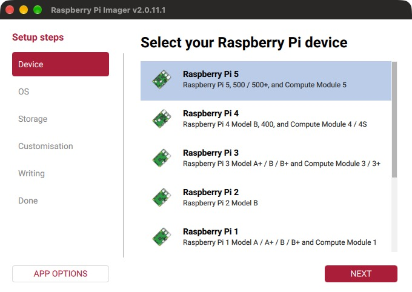
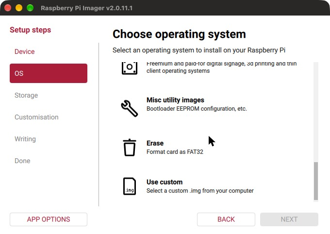
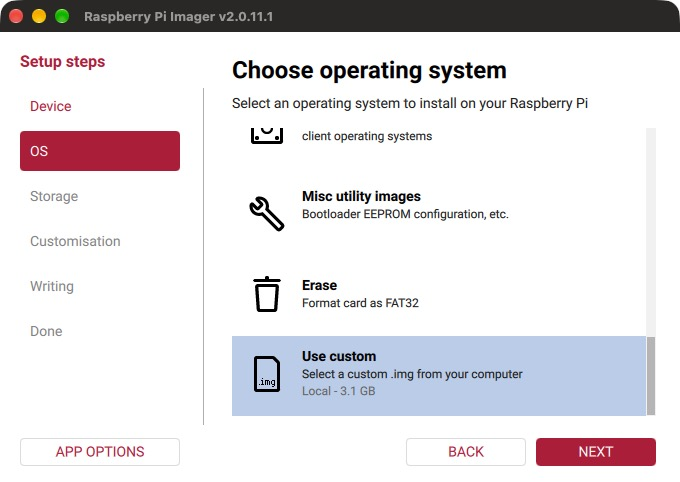

# IPTV Appliance para Raspberry Pi

Convierte un Raspberry Pi en una cajita de IPTV para tu televisor: se enciende y vuelve sola al último canal, se maneja con el control del TV o desde el teléfono, y tiene guía de programación, favoritos, pausa y retroceso, grabaciones y actualizaciones automáticas firmadas.

Aquí están la **imagen para instalarlo** y las **actualizaciones**. Sigue esta guía para instalarlo por primera vez.

Esta guía convierte un Raspberry Pi en una cajita de IPTV para tu televisor. No hace falta saber de programación ni usar teclado o ratón: se graba una microSD, se conecta al TV y se termina de configurar desde el teléfono.

El equipo **no incluye canales**. Necesitas la dirección de tu lista (M3U) que te da tu proveedor de IPTV.

Tiempo total: unos 20 minutos, casi todo esperando a que se grabe la tarjeta.

## Qué necesitas

| Cosa | Detalle |
| --- | --- |
| Raspberry Pi | **Pi 5** (probado) o **Pi 4** (compatible, sin probar todavía). El Pi 3 no sirve para canales HEVC |
| Fuente de poder | La oficial de tu modelo: **27 W USB-C** para el Pi 5, 15 W USB-C para el Pi 4. Con un cargador de teléfono el Pi 5 no arranca o se queda en "No signal" |
| microSD | **32 GB o más**, clase A1 o mejor. Si vas a grabar programas, 64 GB o más |
| Cable HDMI | micro-HDMI a HDMI. Conéctalo al puerto **HDMI 0** del Pi, el que está junto a la entrada de corriente |
| Disipador | Recomendado para el Pi 5 (el Active Cooler oficial) |
| Una computadora | Mac, Windows o Linux, con lector de microSD. Solo para grabar la tarjeta |
| Un teléfono | Para configurar y como control remoto |
| Tu lista de canales | La dirección M3U de tu proveedor y, si la tienes, la de la guía (EPG/XMLTV) |

Internet puede ser por Wi-Fi o por cable de red. Con cable es más estable.

## 1. Descargar la imagen

1. Descarga el archivo de imagen: **[iptv-appliance-1.0.7.img.xz](https://github.com/egar151/IPTV-releases/releases/download/imagen-1.0.7/iptv-appliance-1.0.7.img.xz)** (600 MB).
2. No lo descomprimas: se graba tal cual.

Opcional, para comprobar que bajó completo: su huella sha256 debe ser

```
db937937205d6da3c9c4aaf42160776b3c56b866d2102b614b401a8c2945ec68
```

En Mac o Linux se calcula con `shasum -a 256 iptv-appliance-1.0.7.img.xz`; en Windows, con `certutil -hashfile iptv-appliance-1.0.7.img.xz SHA256`.

## 2. Grabar la microSD

Las capturas son de Raspberry Pi Imager 2.0 en inglés. Si el tuyo está en español, los botones dicen lo mismo traducido.

1. Instala **Raspberry Pi Imager** desde <https://www.raspberrypi.com/software/>.
2. Mete la microSD en la computadora y abre Raspberry Pi Imager.
3. **Device (Dispositivo):** elige tu modelo de Raspberry Pi y pulsa **Next**.

   

4. **OS (Sistema operativo):** baja hasta el **final de la lista** y elige **Use custom** (*Usar personalizado*).

   

5. Se abre una ventana para buscar archivos: selecciona el `.img.xz` que descargaste. "Use custom" queda marcado y debajo dice **Local - 3.1 GB**. Pulsa **Next**.

   

6. **Storage (Almacenamiento):** elige tu microSD y pulsa **Next**. Revisa que sea la correcta: se borra todo lo que tenga.
7. **Customisation (Personalización):** si ofrece configurar usuario, Wi-Fi o SSH, **no pongas nada** (o responde **No**). El equipo se configura solo desde el teléfono, y esos ajustes pueden impedir que arranque bien.
8. **Writing (Escritura):** confirma y espera a que termine de **escribir y verificar** (5 a 10 minutos).
9. Cuando diga **Done**, saca la microSD.

## 3. Conectar y encender

1. Mete la microSD en el Pi.
2. Conecta el cable HDMI al puerto **HDMI 0** del Pi y a tu TV. Si usas cable de red, conéctalo también.
3. Enciende el TV y ponlo en esa entrada HDMI.
4. Conecta la corriente al Pi. No tiene botón de encendido: arranca solo.
5. **Espera 2 minutos.** La primera vez el equipo prepara la tarjeta y se reinicia una vez; la pantalla puede quedar en negro un momento. No lo desconectes.
6. El TV muestra **Bienvenido** con dos códigos QR.

## 4. Configurar desde el teléfono

1. Con la cámara del teléfono, escanea el **primer código QR**. El teléfono se une a la red Wi-Fi **IPTV-Setup-XXXX** (la clave también aparece en el TV).
2. El teléfono abre solo la página de configuración, como el Wi-Fi de un hotel. Si no aparece, escanea el **segundo código** o abre `http://10.42.0.1` en el navegador.
3. Elige **tu red Wi-Fi** y escribe su contraseña. Con cable de red este paso no aparece.
4. Pega la **dirección de tu lista de canales (M3U)**. Si tienes la de la guía (EPG), pégala también. Si tu lista es un archivo, puedes subirlo.
5. Crea un **PIN** de 4 a 8 dígitos y anótalo. Lo pide la página de Ajustes; si lo olvidas hay que restablecer el equipo.
6. Toca **Conectar** y mira el TV: dirá **Conectado** y mostrará un código QR nuevo.
7. Regresa el teléfono a la **Wi-Fi de tu casa**. Escanea ese código o abre `http://iptv.local`. Si no abre, usa la dirección con números (IP) que muestra el TV.

En unos segundos empiezan a verse los canales. La guía de programación puede tardar un par de minutos en llenarse.

> Si la contraseña del Wi-Fi era incorrecta, el teléfono vuelve solo a la red IPTV-Setup y la página lo indica. Corrígela y toca Conectar de nuevo.

## 5. Actualizar a la última versión

La imagen puede traer una versión anterior de la app. Para ponerla al día:

1. En el teléfono abre `http://iptv.local` y toca **Ajustes**. Escribe tu PIN.
2. Baja a **Actualizaciones** y toca **Buscar actualización**.
3. Si dice **Hay una versión nueva**, toca **Instalar** y confirma. Tarda cerca de un minuto y el video se corta unos segundos.

Tus canales, favoritos y ajustes se conservan al actualizar.

## Cómo se usa

- **Teléfono** (`http://iptv.local`): toca un canal para verlo en el TV. Tiene buscador, favoritos, guía, grabaciones y un control con flechas. Puedes agregarlo a la pantalla de inicio del teléfono como si fuera una app.
- **Control del TV** (si tu TV tiene HDMI-CEC: SimpLink en LG, Anynet+ en Samsung, Bravia Sync en Sony):
  - **Flechas arriba / abajo:** cambiar de canal. Los **números** sintonizan directo.
  - **OK:** pausar y seguir. **Izquierda / derecha:** retroceder y adelantar 10 segundos.
  - **Back:** abrir la guía en el TV. Ahí también aparece la dirección del control para el teléfono.
- **Apagar:** apaga el TV como siempre. El equipo deja de reproducir solo y sigue encendido, listo para la próxima vez. No hace falta desconectarlo.

## Si algo falla

| Lo que pasa | Qué hacer |
| --- | --- |
| El TV dice **"No signal"** y el Pi solo tiene luz roja | La fuente de poder no alcanza. Usa la oficial de tu modelo |
| "No signal" con luz verde parpadeando | Revisa que el cable esté en **HDMI 0** y el TV en la entrada correcta. Espera los 2 minutos del primer arranque |
| No aparece la pantalla **Bienvenido** | Vuelve a grabar la microSD, respondiendo **No** a los ajustes de personalización |
| El teléfono no abre la página al unirse a IPTV-Setup | Abre `http://10.42.0.1` en el navegador. Desactiva los datos móviles un momento si el teléfono insiste en usarlos |
| `http://iptv.local` no abre | Usa la IP que muestra el TV (botón **Info** o **Back** del control). Revisa que el teléfono esté en la misma Wi-Fi que el equipo |
| **"No se pudo cargar la lista"** | La dirección M3U está mal o venció. Corrígela en Ajustes |
| **"Reconectando…"** | El canal se cortó; se reintenta solo. Si pasa en todos, revisa tu internet |
| Aviso de **máximo de conexiones** de tu proveedor | Tu plan permite pocas conexiones a la vez. Ajusta el número en Ajustes → Grabaciones y evita ver el mismo plan en otro aparato |
| Se ve pero **no se oye** | Usa el puerto **HDMI 0** del Pi |
| El control del TV no hace nada | Activa HDMI-CEC en los ajustes del TV. En LG las teclas CH+ / CH− no llegan al equipo: usa las flechas |
| Cambiaste de router o de Wi-Fi | A los 2 minutos sin red, el TV vuelve a mostrar **Bienvenido**: repite el paso 4 |

## Empezar de cero

- **Desde el teléfono:** Ajustes → Zona de peligro → **Restablecer de fábrica**. Borra la lista, los favoritos, el PIN y el Wi-Fi, y vuelve a la pantalla Bienvenido.
- **Si olvidaste el PIN:** vuelve a grabar la microSD (pasos 2 a 4).

## Privacidad y seguridad

- La dirección de tu lista y tu PIN se guardan solo en tu equipo.
- El equipo no acepta conexiones desde internet: solo se controla desde tu red.
- Las actualizaciones vienen firmadas; el equipo rechaza cualquier paquete que no tenga la firma correcta.

## Sobre este repositorio

- La imagen para grabar está en el release [`imagen-1.0.7`](https://github.com/egar151/IPTV-releases/releases/tag/imagen-1.0.7).
- Los demás releases (`v1.0.x`) son los paquetes de actualización que los equipos descargan solos: `iptv-app-<versión>.tar.gz`, `manifest.json` y su firma `manifest.json.sig`. No hace falta descargarlos a mano.
- Este repositorio no contiene código fuente.
